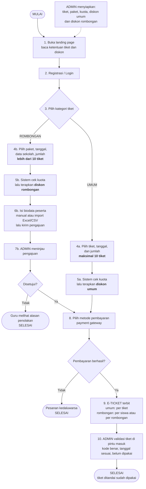
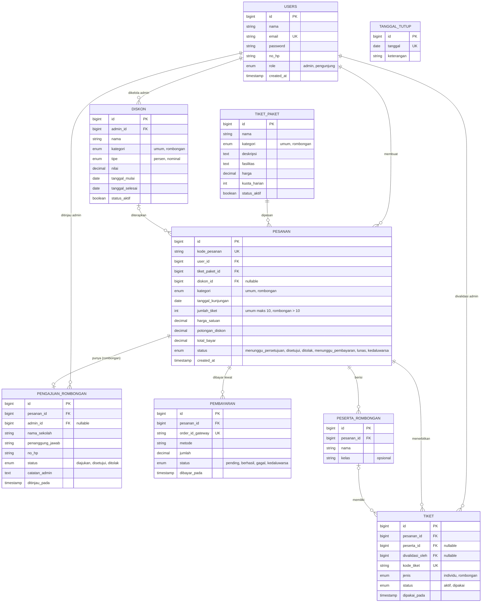

# Analisis Kebutuhan & Penyusunan Backlog: The Nice Park - Rumpin

**Kelompok:** -  
**Nama Client:** The Nice Park - Rumpin  

---

## 1. Temukan Client
* **Nama Client:** The Nice Park - Rumpin

---

## 2. Riset & Analisis Masalah

### Ringkasan Masalah / Hambatan
* Proses pemesanan yang masih dilakukan secara manual.
* Pengunjung masih bingung dan bertanya-tanya tentang pemilihan paket, harga, bahkan cara pemesanannya.
* Untuk pemesanan tiket secara rombongan, petugas masih harus mencatatnya secara manual (data sekolah, penanggung jawab, tanggal kunjungan, dan jumlah peserta).
* Di saat banyak pemesanan yang masuk bersamaan, petugas kesulitan memastikan pesanan tercatat dengan benar dan pembayaran tepat waktu.
* Pengunjung masih harus kembali ke petugas untuk menanyakan status pesanannya.

### Kebutuhan / Harapan Client
* Aplikasi berbasis web yang memungkinkan pengunjung memilih pesanan tiket atau paket secara online, menentukan tanggal kunjungan, melakukan pemesanan, dan membayar secara online (*payment gateway*).
* Untuk paket khusus sekolah/rombongan, petugas ingin dapat melakukan peninjauan dan memberikan persetujuan terhadap pelanggan sebelum mereka melakukan pembayaran.
* Jika pembayaran sudah terverifikasi, pelanggan mendapatkan *e-ticket* dan dapat melihat riwayat pesanan.
* Dari sisi pengelola (The Nice Park), dibutuhkan halaman admin untuk mengelola tiket dan paket wisata, memproses pengajuan sekolah, serta memantau pesanan dan status pembayaran.

### Tujuan Client
* Mempermudah pengunjung untuk membeli tiket umum maupun memesan paket kunjungan sekolah secara online.
* Menyediakan informasi terkait tiket, paket wisata, harga, beserta ketentuan kunjungan secara jelas.
* Membuat pusat pencatatan agar lebih rapi dan meminimalkan kesalahan.
* Memudahkan admin untuk meninjau, menyetujui, dan menolak pengajuan kunjungan dari sekolah.
* Menyediakan *e-ticket* setelah pembayaran dilakukan dan diverifikasi.

---

## 3. Riset & Analisis Kebutuhan

### Ide Solusi / Nama Sistem
Aplikasi berbasis website dengan fitur yang dapat disesuaikan dengan kebutuhan pengelolaan tiket dan kunjungan wisata The Nice Park - Rumpin.

### Fitur Utama (Secara Umum)

#### A. Sisi Admin
* **Dashboard Pengelolaan Tiket & Paket:** Dibagi dua kategori (Umum dan Rombongan) dengan fitur tambah, ubah, hapus, aktif/nonaktif, serta pengaturan harga dan kuota harian.
* **Pengelolaan Diskon:** Mengatur diskon rombongan (pemesanan > 10 tiket) dan diskon umum (pemesanan maks. 10 tiket) secara terpisah, termasuk sistem kalender jadwal diskon otomatis (misal saat hari libur nasional).
* **Monitoring Pengajuan & Pesanan:** Halaman khusus untuk memantau pengajuan kunjungan sekolah, pesanan, dan status pembayaran.
* **Tinjauan Pengajuan Rombongan:** Meninjau detail pengajuan (data sekolah, penanggung jawab, daftar peserta), lalu menyetujui atau menolak beserta catatan alasan.
* **Kelola Semua Pesanan:** Manajemen tiket umum dan rombongan dengan filter tanggal, status, dan jenis tiket.
* **Integrasi Payment Gateway:** Mengelola pembayaran pengunjung dengan pembaruan status otomatis maupun verifikasi manual jika terjadi kendala.
* **Validasi E-Ticket:** Pemindaian (*scan*) atau input kode di pintu masuk; tiket yang sudah dipakai otomatis ditandai agar tidak dapat digunakan kembali.
* **Statistik & Grafik:** *Chart* untuk melihat statistik pemesanan, pembayaran, serta *line chart* pendapatan sesuai tanggal.
* **Ekspor Laporan:** Laporan pesanan dan pendapatan yang dapat diekspor ke format PDF atau Excel.

#### B. Sisi Pengunjung (Umum & Guru/Rombongan)
* **Landing Page & Katalog:** Pengenalan wisata, katalog tiket/paket (umum dan rombongan), harga, diskon, fasilitas, serta ketentuan pemilihan tiket (umum maks. 10 tiket, rombongan > 10 tiket).
* **Autentikasi & Profil:** Registrasi, login, dan edit profil pengguna.
* **Pembelian Tiket Umum:** Pilih tanggal kunjungan (cek kuota) dan jumlah tiket maksimal 10 (jika lebih dari 10 otomatis diarahkan ke paket rombongan), dengan diskon umum diterapkan otomatis.
* **Pemesanan Paket Rombongan (> 10 Anggota):** Pilih paket, isi jumlah anggota (contoh: 25 murid), penerapan diskon rombongan, serta pengisian biodata peserta secara manual atau impor dari Excel/CSV.
* **Status Pengajuan Rombongan:** Pantau status pengajuan (*diajukan*, *disetujui*, atau *ditolak* beserta alasan); akses pembayaran terbuka setelah pengajuan disetujui.
* **Pembayaran Online:** Pembayaran melalui *payment gateway* (satu kali bayar untuk seluruh rombongan).
* **E-Ticket & Opsi Tampilan:** Penerbitan *e-ticket* (nama dan kode unik/QR) yang dapat diunduh sebagai PDF setelah pembayaran terverifikasi. Untuk rombongan tersedia dua opsi tampilan: **per siswa** (sesuai nama) dan **per rombongan** (nama rombongan beserta data siswa).
* **Riwayat & Perubahan Data Peserta:** Melihat riwayat/status pesanan serta mengganti nama peserta rombongan sebelum hari kunjungan.

---

## 4. Product Backlog

| No | User Story | Prioritas | Estimasi Waktu | Catatan |
| :---: | :--- | :---: | :---: | :--- |
| 1 | Sebagai pengunjung, saya ingin registrasi dan login agar riwayat pesanan saya tersimpan. | Tinggi | 2 hari | Registrasi, login, edit profil |
| 2 | Sebagai admin, saya ingin login ke halaman admin agar hanya pengelola yang dapat mengelola data. | Tinggi | 1 hari | Akses dibatasi role admin |
| 3 | Sebagai admin, saya ingin menambah, mengubah, dan menghapus tiket dan paket wisata dalam dua kategori (umum dan rombongan) beserta harga, kuota harian, dan status aktif agar informasi selalu terbaru. | Tinggi | 3 hari | CRUD tiket dan paket |
| 4 | Sebagai admin, saya ingin mengatur diskon rombongan dan diskon umum secara terpisah agar harga promo bisa dikelola. | Tinggi | 3 hari | Diskon umum berbeda dari diskon rombongan |
| 5 | Sebagai pengunjung, saya ingin melihat landing page dan katalog tiket/paket beserta harga, diskon, dan ketentuan pemilihan tiket agar tidak bingung memilih. | Tinggi | 3 hari | Ketentuan: umum maks 10 tiket, rombongan lebih dari 10 tiket |
| 6 | Sebagai pengunjung, saya ingin memilih tanggal kunjungan dan jumlah tiket (maksimal 10) lalu memesan online agar tidak perlu memesan manual. | Tinggi | 3 hari | Cek kuota; jika lebih dari 10 diarahkan ke rombongan; diskon umum otomatis |
| 7 | Sebagai pengunjung, saya ingin membayar pesanan lewat payment gateway agar pembayaran cepat dan tercatat otomatis. | Tinggi | 4 hari | Pakai sandbox Midtrans/Xendit, status via webhook |
| 8 | Sebagai pengunjung, saya ingin menerima e-ticket (kode unik/QR) setelah pembayaran terverifikasi agar bisa langsung dipakai. | Tinggi | 3 hari | Bisa diunduh sebagai PDF |
| 9 | Sebagai pengunjung, saya ingin melihat riwayat dan status pesanan agar tidak perlu bertanya ke petugas. | Tinggi | 2 hari | Status: menunggu bayar, lunas, kedaluwarsa |
| 10 | Sebagai guru, saya ingin mengajukan paket rombongan (lebih dari 10 anggota, tanggal kunjungan, data sekolah) agar rombongan bisa dipesan online dengan diskon rombongan. | Tinggi | 3 hari | Contoh: 25 murid; validasi minimal lebih dari 10 |
| 11 | Sebagai guru, saya ingin mengisi biodata peserta rombongan agar setiap tiket memuat nama siswa. | Tinggi | 2 hari | Jumlah baris sesuai jumlah anggota |
| 12 | Sebagai guru, saya ingin mengimpor nama siswa dari Excel/CSV agar tidak mengetik satu per satu. | Sedang | 3 hari | Sediakan template unduhan dan validasi |
| 13 | Sebagai admin, saya ingin meninjau lalu menyetujui atau menolak pengajuan rombongan beserta alasannya agar kunjungan terkontrol. | Tinggi | 3 hari | Pembayaran terbuka setelah disetujui |
| 14 | Sebagai guru, saya ingin melihat status pengajuan dan membayar setelah disetujui agar proses jelas. | Tinggi | 2 hari | Status: diajukan, disetujui, ditolak |
| 15 | Sebagai guru, saya ingin e-ticket rombongan tampil per siswa dan per rombongan agar fleksibel dipakai saat masuk. | Sedang | 3 hari | Satu data, dua tampilan |
| 16 | Sebagai admin, saya ingin memantau semua pesanan dan status pembayaran agar tidak ada pesanan yang terlewat. | Tinggi | 2 hari | Filter tanggal, status, jenis |
| 17 | Sebagai admin, saya ingin melihat chart statistik pemesanan dan pembayaran per tanggal agar mudah memantau kunjungan. | Sedang | 2 hari | Dashboard |
| 18 | Sebagai admin, saya ingin memvalidasi e-ticket di pintu masuk agar tiket tidak dipakai dua kali. | Sedang | 2 hari | Input atau scan kode |
| 19 | Sebagai admin, saya ingin mengekspor laporan pesanan dan pendapatan agar mudah direkap. | Rendah | 2 hari | PDF/Excel |
| 20 | Sebagai guru, saya ingin mengganti nama peserta sebelum hari kunjungan agar data tetap sesuai. | Rendah | 1 hari | Jumlah peserta tetap |
| 21 | Sebagai pengunjung, saya ingin menerima notifikasi status pesanan lewat email agar tidak perlu mengecek manual. | Rendah | 2 hari | Opsional, bisa ditambah WhatsApp |
| 22 | Sebagai user ataupun admin, saya ingin memakainya di device manapun. | Rendah | 1 hari | 4 tampilan responsif: handphone, tablet, laptop, dan komputer |
| 23 | Sebagai admin, saya ingin ada sistem penghitung pendapatan. | Sedang | 1 hari | Sistem yang menghitung pemasukan |
| 24 | Sebagai admin, saya ingin ada line chart yang bisa menampilkan pendapatan atau pemasukan. | Rendah | 1 hari | Chart yang menampilkan uang masuk |
| 25 | Sebagai admin, saya ingin sistem kalender untuk diskon. | Sedang | 2 hari | Kalender jadwal diskon otomatis (misal saat hari libur nasional, diskon berubah otomatis pada hari-H) |
| 26 | Sebagai admin, saya ingin ada tampilan kalender yang bisa tersambung dengan sistem diskon. | Sedang | 2 hari | Tampilan kalender responsif |

---

## 5. Sprint Backlog

### Sprint 1 - Fondasi, Katalog, dan Diskon (Total: 12 Hari)
| No | User Story | Estimasi Waktu | PIC (Anggota) |
| :---: | :--- | :---: | :---: |
| 1 | Registrasi dan login pengunjung | 2 hari | - |
| 2 | Login admin | 1 hari | - |
| 3 | CRUD tiket dan paket (kategori umum dan rombongan) | 3 hari | - |
| 4 | Kelola diskon umum dan rombongan | 3 hari | - |
| 5 | Landing page, katalog, dan ketentuan pemilihan tiket | 3 hari | - |

### Sprint 2 - Pemesanan Tiket Umum, Pembayaran, & E-Ticket (Total: 14 Hari)
| No | User Story | Estimasi Waktu | PIC (Anggota) |
| :---: | :--- | :---: | :---: |
| 6 | Pilih tanggal dan pesan tiket umum (maks 10) | 3 hari | - |
| 7 | Pembayaran lewat payment gateway | 4 hari | - |
| 8 | E-ticket (kode/QR) dan unduh PDF | 3 hari | - |
| 9 | Riwayat dan status pesanan | 2 hari | - |
| 16 | Admin pantau pesanan dan status pembayaran | 2 hari | - |

### Sprint 3 - Paket Rombongan (Total: 10 Hari)
| No | User Story | Estimasi Waktu | PIC (Anggota) |
| :---: | :--- | :---: | :---: |
| 10 | Pengajuan paket rombongan (lebih dari 10 anggota) | 3 hari | - |
| 11 | Isi biodata peserta rombongan | 2 hari | - |
| 13 | Admin tinjau, setujui, tolak pengajuan | 3 hari | - |
| 14 | Status pengajuan dan pembayaran rombongan | 2 hari | - |

### Sprint 4 - Pelengkap (Total: 10 Hari)
| No | User Story | Estimasi Waktu | PIC (Anggota) |
| :---: | :--- | :---: | :---: |
| 12 | Import nama siswa dari Excel/CSV | 3 hari | - |
| 15 | E-ticket rombongan (per siswa dan per rombongan) | 3 hari | - |
| 16 | Kalender auto + diskon | 3 hari | - |
| 17 | Chart modern di dashboard | 2 hari | - |
| 18 | Validasi e-ticket di pintu masuk | 2 hari | - |

---

## 6. User Flow

---

## 7. ERD (Entity Relationship Diagram)

